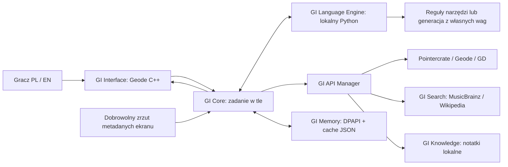

# Architektura Geometry Intelligence

Interfejs gry i silnik AI działają w osobnych procesach. Dzięki temu trening, awaria modelu lub długie generowanie nie wykonują obliczeń na głównym wątku gry.



## Dwa warianty językowe

**Istniejący lokalny model:** ten sam klient C++ można skierować do serwera zgodnego z Chat Completions, obsługującego `tools` i opcjonalnie SSE. Korzystanie z cudzych wag, RAG i dodanie instrukcji nie są treningiem własnego modelu od zera. Fine-tuning również zaczyna od cudzych wag. Ten wariant może dać znacznie lepszą rozmowę, ale nie jest domyślnie instalowany ani używany.

**Model od zera, wybrany przez użytkownika:** `TinyGI` losuje parametry i uczy je przez minimalizowanie błędu przewidywania kolejnego tokenu. PyTorch dostarcza działania na tensorach i gradienty; nie dostarcza wiedzy ani pretrained weights. Generowanie to kolejne przewidywania sieci. Dataset nie jest wczytywany przez serwer jako tablica odpowiedzi.

Model ma zbyt mało danych, żeby wiarygodnie wybierać narzędzia i przepisywać liczby. Dlatego `routing.py` jawnie realizuje reguły wyboru, a `evidence.py` formatuje fakty. To konwencjonalne oprogramowanie wspomagające mały model. Nie nazywamy go wyuczonym rozumowaniem. Większy przyszły model może przejąć te funkcje bez przebudowy interfejsu.

## Mapa modułów

| Moduł | Pliki | Odpowiedzialność |
|---|---|---|
| GI Core | `src/ai/Engine.cpp`, `include/gi/Engine.hpp` | Kontekst, kontrakt modelu, 5 rund, maks. 10 wywołań narzędzi, 24 źródła |
| GI Language Engine | `python/gi_model/model.py`, `train.py`, `serve.py` | Sieć, trening, zapis/odczyt własnych wag, API lokalne |
| GI Knowledge | `src/knowledge/Knowledge.cpp`, `resources/knowledge.json` | Ranking notatek według słów, PL/EN, źródło i data przeglądu |
| GI Search | `python/gi_model/routing.py`, `src/api/FreeSearch.cpp` | Rozpoznanie częstych intencji i ograniczone wyszukiwanie |
| GI API Manager | `src/api/KnowledgeApi.cpp`, `GameApi.cpp`, `Http.cpp` | Lista dozwolonych narzędzi, zapytania, walidacja, cache, rate limits |
| GI Memory | `src/storage/Store.cpp`, `Credentials.cpp` | Historia DPAPI, cache, opcjonalne klucze w Windows Credential Manager |
| GI Game Context | `src/ui/GameContext.cpp`, `src/main.cpp` | Kopia dozwolonych danych widocznego levela, wyłącznie po zgodzie |
| GI Interface | `src/ui/AssistantPopup.cpp`, `Controller.cpp` | Okno, przyciski, kolejka pracy i odświeżanie UI |

## Przepływ konkretnego pytania

`What is the current Top 1 Demon?` trafia do lokalnego serwera. Router wybiera `demonlist(operation=top,count=1)`. C++ sprawdza zgodę na publiczne API, odczytuje aktualny cache lub odpytuje Pointercrate, waliduje JSON i przypisuje źródło. Serwer odsyła jawny odczyt narzędzia. C++ zapisuje wynik i obiekt dowodów w bieżącej rozmowie.

Przy `Who created it?` router odczytuje identyfikator demona z dowodów poprzedniej odpowiedzi i wywołuje endpoint szczegółów. Nie utożsamia autora z publikującym. Pytanie o Move wybiera lokalne notatki, bez zapytania do Pointercrate.

## Kontrakty i granice

- API serwera: `GET /health`, `GET /v1/models`, `POST /v1/chat/completions`. To endpointy naszego serwera, zaimplementowane w `serve.py`.
- Obsługiwane wywołania: `demonlist`, `geode_mods`, `levels`, `song_info`, `web_search`, `editor_knowledge`, `game_context`. Nie ma narzędzia uruchamiania kodu, edycji poziomu ani pobierania dowolnego URL.
- Wiadomości modelu: role `system`, `user`, `assistant`, `tool`; narzędzia mają `id`, `function.name`, JSON w `function.arguments`. C++ waliduje odpowiedzi i ogranicza liczbę iteracji.
- SSE jest składane z rzeczywistych fragmentów sieciowych. Niepełny strumień bez zakończenia jest błędem. Fakty z narzędzi mogą przyjść w jednym fragmencie; nie udajemy generacji literka po literce.
- Źródło zawiera `title`, `url`, `fetched_at`, `confidence`, `cached`, `data`. `fetched_at` oznacza czas pobrania, a nie automatycznie datę ostatniej zmiany u dostawcy. Notatki mają datę przeglądu; zrzut gry ma osobne `captured_at`.
- Historia wysyłana modelowi jest ograniczona do 24 wiadomości i budżetu bajtów. Własna sieć widzi jedynie ostatnie 256 tokenów bajtowych. Reguły narzędzi mogą odczytać szerszą historię dowodów. To dwie różne pojemności kontekstu.

## Wątki i stabilność

Na głównym wątku działają tylko Cocos UI, odczyt ustawień i kopiowanie małych danych gry. Sieć, model, DPAPI i zapis plików pracują w zadaniu w tle. Worker nie trzyma wskaźników do okna ani obiektów levela. UI odczytuje stan co 250 ms; nie kopiuje do widoku dużych JSON-ów źródeł. W jednym momencie działa jedno zadanie klienta i jedna generacja serwera.

Geode 5.11.2 udostępnia asynchroniczny web API, który buforuje treść. Zwykłe żądania korzystają z `GeodeHttp`; streaming używa Windows WinHTTP na workerze, z callbackiem fragmentów i anulowaniem uchwytu. Żaden callback HTTP nie manipuluje Cocos nodes.

Są limity treści, timeouty, obsługa 429, odstępy zapytań, brak automatycznych przekierowań z kluczami i odrzucanie niepoprawnego JSON. Nie jest to dowód braku wszystkich błędów: obciążenie UI, zamykanie gry podczas żądania i konflikty modów wymagają testów w GD.

## Drzewo projektu

```text
Geometry Intelligence Geode Mod/
  CMakeLists.txt, mod.json, about.md, changelog.md, README.md, LICENSE
  Start_AI.cmd, Setup_AI.cmd, Check_AI.cmd, Train_AI.cmd
  include/gi/                 # interfejsy C++
  src/
    main.cpp                  # hooki menu, pauzy i ekranu edycji
    ai/                       # Engine, parser SSE
    api/                      # dostawcy, transporty HTTP, parsowanie GD
    knowledge/                # wyszukiwanie notatek
    storage/                  # historia, cache, Credential Manager
    ui/                       # popup, worker controller, zrzut ekranu
    utils/                    # tekst, URL, walidacja
  resources/                  # wiedza, font PL, licencja OFL
  python/
    gi_model/                 # model, trainer, router, evidence, server
    data/                     # jawne przykłady JSONL i ich pochodzenie
    models/                   # własne checkpointy; poza Git
    tests/                    # sieć, trening, API lokalne, routing
    build_starter.py, build_domain.py, evaluate_samples.py, export_model.py
    requirements.txt
  tests/                      # core_tests.cpp, api_probe.cpp
  scripts/                    # kompilacja, instalacja AI, testy, paczka
  docs/                       # instrukcje i wyniki
  third_party/                # nlohmann/json + licencja
  dist/                       # .geode, archiwum, SHA256
  test-output/                # faktyczne wyniki testów, poza Git
  .venv/, .tooling/, .research/, build/  # lokalne środowisko; poza paczką źródeł
```

Pełny aktualny spis plików dostarczanej paczki generuje `scripts/package.py` w `dist/FILES.txt`.
